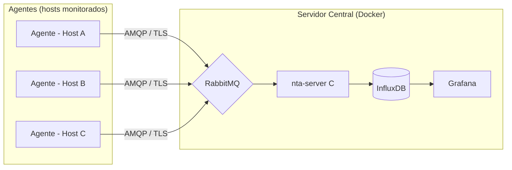

# Network Traffic Analyzer


> **Versão atual: v8.1** — agente nativo no Windows (Windows Service + instalador em [Releases](https://github.com/EduardoMartins-Dev/Network-Traffic-Analyzer/releases)), servidor inteiro em Docker (`nta-server` em container) e reconexão automática ao RabbitMQ.
>
> **v8.0** — Threat Intelligence em C: GeoLite2-City+ASN, framework IoC (blocklist.json), AbuseIPDB enricher (libcurl+cache 24h) com dual-trigger narrator (kc_score OR abuse_score) e WHOIS nativo (TCP socket :43, sem libs externas) enriquecendo prompt LLM.

O **Network Traffic Analyzer** é um sistema de monitoramento e detecção de intrusão (IDS) de alta performance desenvolvido em C (C11), com arquitetura inspirada no modelo **Agent/Server do Zabbix**.

Cada agente roda em um host monitorado, captura pacotes via libpcap/Npcap, detecta ataques comportamentalmente com **baseline EWMA adaptativo** e **kill chain correlator**, e envia os eventos enriquecidos com tags MITRE ATT&CK para um servidor central via AMQP.

O `nta-server` é um servidor em C (v7.0) que substituiu o ingestor Python da v6.0, com pool de workers adaptativo (auto-scale via Mgmt API), narrativa LLM em C (libcurl→Groq) e métricas próprias (`nta_pool`, `incident_narrative`).

---

## Aviso de Segurança

> Este software foi desenvolvido estritamente para fins educacionais e de pesquisa em segurança defensiva (Blue Team).
>
> - Execute exclusivamente em redes laboratoriais isoladas, redes privadas autorizadas ou localhost.
> - O autor não se responsabiliza pelo uso em monitoramento não autorizado.

---

## Detecções (v4.0)

O motor IDS cobre 10 vetores de ataque com detecção comportamental adaptativa:

| Detecção | Protocolo | MITRE ATT&CK | Descrição |
|---|---|---|---|
| Port Scan | TCP | T1046 | ≥15 portas únicas por IP |
| ICMP Flood | ICMP | T1498 | Volume anômalo de pacotes ICMP |
| SYN Flood | TCP | T1498 | SYNs sem ACK acima do baseline |
| Null Scan | TCP | T1046 | Pacotes com flags=0x00 |
| Xmas Scan | TCP | T1046 | FIN+PSH+URG simultâneos |
| SYN/FIN Scan | TCP | T1046 | SYN+FIN simultâneos (inválido por RFC) |
| Brute Force | TCP | T1110 | ≥30 SYNs para portas 22/21/3389 em 60s |
| DNS Tunneling | UDP/DNS | T1071.004, T1048 | Entropia alta / subdomain longo / volume anômalo |
| ARP Spoofing | ARP | T1557 | MAC reivindicando IPs diferentes |
| DDoS Amplification | UDP/DNS | T1498 | Ratio response/request > 10:1 |

> **DDoS Amplification:** o alerta sai pelo IP do refletor. Um refletor DNS que só envia respostas é detectado quando o sensor vê a consulta forjada com origem e destino fora de `HOME_NET` (o analyzer conta a consulta também no servidor de destino). Não detecta com a vítima dentro de `HOME_NET` (por exemplo, no gateway da vítima), porque essa consulta é descartada pelo filtro de `HOME_NET`. Um resolvedor com mistura de consultas DNSKEY/ANY, em que a proporção de respostas grandes fica entre cerca de 60 % e 70 %, pode disparar (falso positivo). Esse limite foi medido só com pcap sintético. Ver [tests/pcaps/README.md](tests/pcaps/README.md).

### Baseline EWMA adaptativo

Cada IP rastreado mantém médias móveis exponencialmente ponderadas de pps, portas/min e DNS queries/min. Os thresholds hardcoded são usados apenas durante a calibração (primeiras 100 amostras); depois, o IDS aprende os limites normais de cada rede.

### Kill Chain Correlator

Máquina de estados por IP: `IDLE → RECON → EXPLOIT → EXFIL → COMPLETE`

Cada detecção avança o estágio e acumula um score 0–100. Todos os eventos de um mesmo incidente são correlacionados e publicados com `kill_chain_stage`, `kc_score` e `mitre_technique` no JSON.

### Camada ATT&CK Navigator

`scripts/mitre_layer.py` gera a camada do [ATT&CK Navigator](https://mitre-attack.github.io/attack-navigator/) com as técnicas que o NTA emite. A fonte é `attack_to_mitre()` em `src/agent/analysis/analyzer.c`, lida pelo próprio script:

```sh
scripts/mitre_layer.py -o nta-mitre-layer.json   # sem -o, imprime no stdout
python3 scripts/test_mitre_layer.py              # testa o script contra o analyzer.c
```

No Navigator, use *Open Existing Layer > Upload* com o JSON gerado.

---

## Pipeline Multi-Thread (v5.0)

O agente roda 4 threads conectadas por ring buffers **SPSC lock-free** (C11 atomics, acquire/release):

```
┌──────────────┐  rb_pkt   ┌──────────────┐  rb_evt   ┌──────────────┐
│  capture_th  │ ────────► │  analysis_th │ ────────► │  publish_th  │
│ (SCHED_FIFO) │ pkt_slot  │  (analyzer)  │ event_slot│ (batch AMQP) │
└──────────────┘           └──────────────┘           └──────────────┘
                                                     │
                                           ┌─────────┴──────────┐
                                           │    metrics_th      │
                                           │ (routing separada) │
                                           └────────────────────┘
```

- **captura** eleva prioridade com `SCHED_FIFO` e chama `pcap_loop`, copiando cada pacote em `rb_pkt` e retornando imediatamente.
- **análise** consome `rb_pkt`, executa EWMA + kill chain e enfileira eventos em `rb_evt`.
- **publicação** agrupa até `AGENT_BATCH_SIZE` eventos (ou `AGENT_BATCH_TIMEOUT_MS`) em um único array JSON via cJSON e dispara uma única chamada AMQP.
- **métricas** publica periodicamente em `AGENT_METRICS_QUEUE` (profundidade dos buffers, overflows, events/s).

Shutdown gracioso: `SIGINT`/`SIGTERM` → `pcap_breakloop` → threads drenam a pipeline e fazem flush final.

---

## Arquitetura

```
[Host A] libpcap → Agente C ──┐
[Host B] libpcap → Agente C ──┼──→ RabbitMQ Central → InfluxDB → Grafana
[Host C] libpcap → Agente C ──┘
```



| Componente | Onde roda | Função |
|---|---|---|
| **Agente (C)** | Host monitorado | Captura, detecta (EWMA + kill chain), publica telemetria |
| **RabbitMQ** | Servidor central | Buffer de mensagens durável |
| **nta-server (C)** | Servidor central (container) | RabbitMQ → InfluxDB com enriquecimento GeoIP/ASN, IoC, AbuseIPDB, WHOIS e narrativa LLM |
| **InfluxDB** | Servidor central | Armazena séries temporais |
| **Grafana** | Servidor central | Dashboards e alertas em tempo real |

---

## Estrutura de Diretórios

```
Network-Traffic-Analyzer/
├── include/
│   ├── agent/                # Headers do agente
│   │   ├── analyzer.h        #   motor IDS (EWMA + kill chain)
│   │   ├── capture.h         #   captura libpcap/Npcap + --list-interfaces
│   │   ├── cli.h             #   modos de execução e parsing de argumentos
│   │   ├── config.h          #   --config (arquivo CHAVE=VALOR)
│   │   ├── netif.h           #   descoberta de HOME_NET por plataforma
│   │   ├── nta_net.h         #   cabeçalhos IPv4/TCP/UDP portáveis
│   │   ├── pipeline.h        #   pipeline multi-thread (4 threads)
│   │   ├── publisher.h       #   cliente AMQP com reconexão
│   │   ├── replay.h          #   replay de .pcap + gabaritos
│   │   ├── rules.h           #   limiares dos detectores (AGENT_RULES_FILE)
│   │   ├── ringbuf.h         #   ring buffer SPSC lock-free
│   │   └── service.h         #   Windows Service (NTAAgent)
│   ├── bridge/               # Headers do nta-eve-bridge (eve_*.h)
│   └── server/               # Headers do nta-server (nta_*.h)
├── src/
│   ├── agent/
│   │   ├── main.c / cli.c    # entrada e linha de comando
│   │   ├── analysis/         # analyzer.c (10 detectores), rules.c (limiares) + collector.c
│   │   ├── capture/          # capture.c
│   │   ├── core/             # pipeline.c, ringbuf.c, config.c
│   │   ├── output/           # publisher.c (batch AMQP + métricas)
│   │   ├── platform/         # netif_posix.c, netif_win32.c, service_win32.c
│   │   └── replay/           # replay.c (--replay / --replay-dir)
│   ├── bridge/               # nta-eve-bridge: ponte do eve.json do Suricata (POSIX)
│   └── server/               # nta-server: consumer AMQP, InfluxDB, GeoIP, IoC,
│                             #   AbuseIPDB, WHOIS, narrator Groq, scaler, /health
├── third_party/cjson/        # cJSON (vendored)
├── tests/
│   ├── unit/                 # testes unitários (ctest)
│   ├── eve/                  # EVE de exemplo e golden do --dry-run da ponte
│   ├── pcaps/                # 33 PCAPs sintéticos + gabaritos (gen_pcaps.py)
│   ├── fuzz/                 # harness libFuzzer do parser, do carregador de limiares e da ponte
│   └── bench/                # benchmark de throughput pps (opcional)
├── installer/                # instalador Windows (Inno Setup)
├── scripts/
│   ├── up.sh / down.sh       # sobe/derruba a stack do servidor (containers)
│   ├── quickstart.sh         # install + up + smoke em um comando
│   ├── install.sh            # dependências por SO + build do agente
│   ├── smoke-test.sh         # build + replay + sniff curto
│   ├── ioc_update.sh         # baixa feed IoC (Feodo), valida, troca blocklist e SIGHUP
│   ├── mitre_layer.py        # camada ATT&CK Navigator (test_mitre_layer.py testa)
│   ├── gen_agent_cert.sh     # CA + certs mTLS (broker e agentes)
│   ├── provision_agent.sh    # user RabbitMQ + cert + env de um agente
│   ├── influx_retention.sh   # retention 7d/90d + downsampling
│   ├── ctl.py / agent_ctl.py # control plane multi-agente (pika)
│   └── dash_gen.py           # gera dashboard Grafana via LLM
├── deploy/
│   ├── nta-server.Dockerfile # imagem do nta-server (usada pelo compose)
│   ├── agent.env.example     # config do agente (--config / systemd / serviço Windows)
│   ├── agent.service         # unit systemd do agente (Linux)
│   ├── eve-bridge.env.example # config da ponte EVE do Suricata (B17)
│   ├── eve-bridge.mapping.json # categoria -> estágio e severidade -> score da ponte
│   ├── rules/                # limiares.example.json e README (AGENT_RULES_FILE)
│   ├── ioc/                  # blocklist.json.example e README.md (feeds e recarga)
│   ├── rabbitmq/             # rabbitmq.conf (TLS/mTLS) + plugins
│   └── secrets/              # *.env.example (Groq, AbuseIPDB); certs gerados
├── data/                     # GeoLite2 (.mmdb baixados à parte — ver READMEs)
├── grafana/                  # provisioning (datasource, dashboards, alertas)
├── .github/workflows/        # test-ids.yml (CI) + release.yml (tags v*)
├── docker-compose.yml
├── .env.example              # credenciais da stack (copiar para .env)
├── requirements.txt          # pika (scripts/ctl.py, agent_ctl.py) e requests (scripts/dash_gen.py)
└── CMakeLists.txt            # agente, nta-server (NTA_BUILD_SERVER) e testes
```

---

## Instalação

### Caminho rápido (recomendado)

Um comando do clone até o stack rodando:

```bash
make quickstart
# ou: ./scripts/quickstart.sh
```

Equivale a `install.sh` (instala dependências + builda agente) → `up.sh` (sobe
a stack docker, incluindo o nta-server) → `smoke-test.sh` (valida com replay). Idempotente.

Outros atalhos:

```bash
make install                # só instala deps + builda (não sobe nada)
make install-server         # só dependências do servidor
make install-agent          # só dependências/build do agente
make up                     # sobe stack (background)
make down                   # derruba tudo
make help                   # lista todos os targets
```

`scripts/install.sh` detecta automaticamente Debian/Ubuntu/Kali (apt),
Fedora/RHEL/CentOS (dnf), Arch (pacman), FreeBSD (pkg) e macOS (brew).

---

### Arquitetura

Dois papéis, tipicamente em máquinas separadas:

- **Servidor Central** — agrega eventos de múltiplos agentes (RabbitMQ + InfluxDB + Grafana + nta-server em C com narrator via Groq), tudo em containers.
- **Agente Sensor** — captura tráfego local e publica no servidor (binário C).

As dependências não se sobrepõem: servidor não precisa de `libpcap` nem
compilador; agente não precisa de Docker nem Python.

---

### Servidor Central — instalação manual

Use só se `make install-server` não funcionar no seu SO.

#### Pré-requisitos

- Runtime OCI: Docker Engine, Docker Desktop, Podman (rootless) ou Podman Desktop
- Python 3.10+ com `pip` e `venv`

**Debian / Ubuntu / Kali:**
```bash
sudo apt update
sudo apt install docker.io docker-compose-plugin python3 python3-venv python3-pip
```

**Fedora / RHEL / CentOS:**
```bash
sudo dnf install moby-engine docker-compose python3 python3-pip
```

> `docker compose` (plugin, sem hífen) e `podman-compose` são equivalentes ao
> `docker-compose` usado nos comandos deste README.

#### Subir o stack

```bash
./scripts/up.sh                 # stack completa em containers, incl. nta-server
./scripts/up.sh --foreground    # idem + acompanha os logs do nta-server
./scripts/up.sh --no-ingest     # só infra (sem o container nta-server)
```

O servidor inteiro roda em containers — funciona igual em Linux, macOS e
Windows (Docker Desktop + Git Bash). O `nta-server` é compilado na imagem
(`deploy/nta-server.Dockerfile`) e expõe `/health` em `127.0.0.1:9091`.

Manual (sem scripts):
```bash
./scripts/gen_agent_cert.sh server   # obrigatório: rabbitmq.conf exige os certs TLS
cp .env.example .env                 # credenciais (recomendado) e alertas Telegram
docker compose up -d --build
```

Acesso (credenciais do `.env`; defaults de desenvolvimento entre parênteses):
- Grafana — http://\<host>:3000 · admin/`GRAFANA_ADMIN_PASSWORD` (admin) *(datasource InfluxDB + dashboard "Network Traffic Analyzer — Visão Geral" já provisionados em `grafana/`)*
- RabbitMQ Management — http://\<host>:15673 · `RABBITMQ_USER`/`RABBITMQ_PASS` (nta/nta-dev-password)

> Usuários, senhas e token só são aplicados na **primeira** subida (volumes
> `rabbitmq_data/` e `influxdb_data/` vazios). Em instalação existente, altere
> pelos próprios serviços ou recrie os volumes.

Exportação de alertas para SIEM (CEF ou ECS via syslog) é opcional e vem desligada: defina `NTA_EXPORT_FORMAT` no `.env` (variáveis e exemplo em [`deploy/nta-export.env.example`](deploy/nta-export.env.example)).

#### Agentes: credenciais no RabbitMQ

Um agente no mesmo host pode usar `AGENT_ID`/`AGENT_TOKEN` = `RABBITMQ_USER`/`RABBITMQ_PASS`.
O user `guest` **só aceita login de `localhost`** e não é criado pela stack. Para cada agente remoto:

```bash
docker exec rabbitmq rabbitmqctl add_user agente-01 <senha-forte>
docker exec rabbitmq rabbitmqctl set_permissions -p / agente-01 ".*" ".*" ".*"
```

Depois preencha `AGENT_ID=agente-01` / `AGENT_TOKEN=<senha-forte>` no arquivo
de ambiente do agente.

---

### Agente Sensor — instalação manual

Use só se `make install-agent` não funcionar.

#### Pré-requisitos

**Debian / Ubuntu / Kali:**
```bash
sudo apt update
sudo apt install build-essential cmake git libpcap-dev librabbitmq-dev libcurl4-openssl-dev libmaxminddb-dev pkg-config
```

**Fedora / RHEL / CentOS:**
```bash
sudo dnf install gcc cmake make git libpcap-devel librabbitmq-devel libcurl-devel libmaxminddb-devel pkgconfig
```

**FreeBSD:**
```sh
sudo pkg install cmake git rabbitmq-c curl libmaxminddb pkgconf    # libpcap já vem na base
```

> No FreeBSD as interfaces seguem o driver: `em0`, `igb0`, `re0`, `wlan0`.

#### Compilar

```bash
cmake -B build -S .
cmake --build build -j$(nproc)
```

Binário gerado: `build/NetworkTrafficAnalyzer`.

#### Capturar sem sudo (recomendado)

```bash
sudo setcap cap_net_raw,cap_net_admin+ep ./build/NetworkTrafficAnalyzer
```

Reaplicar após cada rebuild — o arquivo é substituído e perde a capability.

#### Configurar

```bash
sudo install -Dm640 deploy/agent.env.example /etc/default/nta-agent
sudo $EDITOR /etc/default/nta-agent    # preencha AGENT_SERVER_HOST e AGENT_TOKEN
```

Todas as variáveis estão documentadas em
[Configuração do Agente](#configuração-do-agente-variáveis-de-ambiente).

#### Rodar

**One-shot (desenvolvimento):**
```bash
set -a; source /etc/default/nta-agent; set +a
./build/NetworkTrafficAnalyzer "$AGENT_IFACE"
```

**Produção (systemd):**
```bash
sudo install -Dm755 build/NetworkTrafficAnalyzer /opt/nta-agent/NetworkTrafficAnalyzer
sudo install -Dm644 deploy/agent.service /etc/systemd/system/nta-agent.service
sudo systemctl daemon-reload
sudo systemctl enable --now nta-agent
sudo journalctl -u nta-agent -f
```

#### Windows (agente)

Toolchain: **MinGW-w64 via [MSYS2](https://www.msys2.org/) (UCRT64)**. MSVC não é
suportado — o pipeline usa atômicos C11, ainda experimentais no MSVC.

- [Npcap](https://npcap.com/) (runtime), opções padrão — o modo compatível com WinPcap não é necessário
- [Npcap SDK](https://npcap.com/dist/npcap-sdk-1.16.zip) extraído em `C:\Npcap-sdk`
- Pacotes MSYS2 (terminal **UCRT64**):

```bash
pacman -S --needed mingw-w64-ucrt-x86_64-{gcc,cmake,ninja,rabbitmq-c}
cmake -S . -B build -G Ninja -DCMAKE_BUILD_TYPE=Release -DNPCAP_SDK_DIR="C:/Npcap-sdk"
cmake --build build
./build/NetworkTrafficAnalyzer.exe --replay-dir tests/pcaps   # valida: Score agregado 100.0% (26/26); 33 pcaps, 7 com gabarito vazio
./build/NetworkTrafficAnalyzer.exe --list-interfaces          # \Device\NPF_{GUID}
```

Não precisa ser Administrador, a menos que o Npcap tenha sido instalado com
"Restrict Npcap driver's access to Administrators only". O `.exe` é linkado
estático (rabbitmq-c, OpenSSL, winpthreads): só depende do Npcap instalado.

#### Instalador (recomendado)

Baixe o `NTA-Agent-Setup-<versão>.exe` em
[Releases](https://github.com/EduardoMartins-Dev/Network-Traffic-Analyzer/releases)
(pré-requisito: [Npcap](https://npcap.com/#download), opções padrão).
O assistente pede servidor, porta, usuário/token e a interface de captura, grava
`C:\ProgramData\NTA\agent.conf` (legível só por SYSTEM/Administradores — guarda o
token) e registra/inicia o serviço. Atualizar = rodar o instalador novo (a config
é mantida). Implantação em massa, sem interface:

```powershell
NTA-Agent-Setup-1.0.0.exe /VERYSILENT /SUPPRESSMSGBOXES /SERVER=10.0.0.5 /PORT=5674 `
  /USER=agente-01 /TOKEN=<senha> /IFACE=\Device\NPF_{GUID}
```

Gerar localmente: `iscc /DAppVersion=1.0.0 installer\nta-agent.iss` (após o build).
Releases são gerados pelo CI ao publicar uma tag `v*` (`.github/workflows/release.yml`).

#### Windows Service

O agente roda como serviço `NTAAgent` (início automático, conta LocalSystem,
reinício automático em falha). Configuração num arquivo `CHAVE=VALOR` com as
mesmas chaves de `deploy/agent.env.example` — inclusive `AGENT_IFACE`.

```powershell
# PowerShell como Administrador
mkdir C:\ProgramData\NTA
copy deploy\agent.env.example C:\ProgramData\NTA\agent.conf   # edite host/token/AGENT_IFACE
.\build\NetworkTrafficAnalyzer.exe --install-service --config C:\ProgramData\NTA\agent.conf
sc.exe start NTAAgent
Get-Content C:\ProgramData\NTA\agent.log -Wait                 # log (AGENT_LOG_FILE)
sc.exe stop NTAAgent                                           # shutdown gracioso
.\build\NetworkTrafficAnalyzer.exe --uninstall-service
```

---

## Como Rodar

### Modo live — captura de interface

```bash
# Lista as interfaces de captura (no Windows: \Device\NPF_{GUID})
./build/NetworkTrafficAnalyzer --list-interfaces

# Com interface escolhida (Linux: root OU setcap aplicado)
./build/NetworkTrafficAnalyzer eth0
```

### Modo replay — validar IDS contra pcap (v4.1)

Não requer privilégio nem RabbitMQ em execução.

```bash
# Arquivo único com gabarito
./build/NetworkTrafficAnalyzer \
  --replay tests/pcaps/syn-flood.pcap \
  --expect tests/pcaps/syn-flood.json

# Diretório completo com relatório JSON
./build/NetworkTrafficAnalyzer \
  --replay-dir tests/pcaps/ \
  --report tests/report.json
```

> `tests/pcaps/` tem 33 `.pcap` sintéticos e determinísticos, cada um com gabarito `.json`. 26 têm detecções esperadas. Os outros 7 têm gabarito vazio (`expected: []`): `malformed`, `dns-normal`, `vlan-malformado`, `frag-ipv4-nao-inicial`, `frag-ipv4-tiny`, `ipv6-benign` e `ipv6-malformed`. Com `--replay` de arquivo único, um gabarito vazio sai com rc 0 se não houver alerta e com rc 1 se houver; `--replay-dir` deixa esses arquivos fora do score agregado. Os arquivos são gerados por `tests/pcaps/gen_pcaps.py`. Para tráfego real, consulte [tests/pcaps/README.md](tests/pcaps/README.md).

Saída esperada:

```
[REPLAY] Processando: tests/pcaps/syn-flood.pcap

RESULTADO      ATTACK_TYPE     SRC_IP
---------      -----------     ------
[PASS]         SYN_FLOOD       192.168.1.100

Score: 100.0%  (1/1 detecções corretas)
```

### Smoke test — validação rápida da v5.0

Atalho que executa **build + replay-dir** (e opcionalmente um sniff curto na
interface real):

```bash
./scripts/smoke-test.sh                      # build + replay
sudo ./scripts/smoke-test.sh --live eth0     # adiciona 10s de captura
```

---

## Exportação SIEM (B11)

O `nta-server` pode enviar **alertas** a um SIEM por syslog RFC 5424, em CEF (v0) ou ECS 8.11.0. Desligado por padrão. Só vira alerta o evento com `attack_type` não vazio e diferente de `NONE`. OCSF não está implementado.

| Variável | Default | Descrição |
|---|---|---|
| `NTA_EXPORT_FORMAT` | _(vazio = desligado)_ | `cef` ou `ecs` |
| `NTA_EXPORT_SYSLOG_HOST` | _(nenhum)_ | Destino do syslog. Obrigatória quando o export está ligado |
| `NTA_EXPORT_SYSLOG_PORT` | `514` | Porta do destino (1 a 65535) |
| `NTA_EXPORT_SYSLOG_PROTO` | `udp` | `udp` (RFC 5426) ou `tcp` (octet-counting, RFC 6587) |
| `NTA_EXPORT_HOSTNAME` | `nta-server` | HOSTNAME do cabeçalho RFC 5424 |
| `NTA_EXPORT_QUEUE` | `1024` | Tamanho da fila entre o consumer e a thread de envio (16 a 65536). Fila cheia descarta e conta |
| `NTA_EXPORT_TIMEOUT_MS` | `500` | Timeout de conexão e de envio (50 a 10000) |

Falha no destino não bloqueia o consumo da fila: a exportação tem thread própria e descarta e conta o que não cabe. O `docker-compose.yml` repassa essas variáveis ao serviço `nta-server` (valor vazio = desligado). Modelo comentado: `deploy/nta-export.env.example`.

## Ponte EVE do Suricata (`nta-eve-bridge`, B17)

Processo auxiliar **ao lado do agente**, na máquina do Suricata. Lê o `eve.json` (só `event_type` = `alert`) e publica eventos NTA na `traffic_queue`, usando as credenciais AMQP do agente (`AGENT_*`, mTLS incluído). O servidor, o InfluxDB e o Grafana não mudam: o alerta aparece como `traffic` com `attack_type` `SURICATA_<categoria>`. Sem a ponte rodando, nada muda. Só POSIX (Linux, FreeBSD, macOS); não é construída no Windows.

```bash
cmake --build build --target nta-eve-bridge
BRIDGE_EVE_PATH=/var/log/suricata/eve.json \
BRIDGE_MAPPING_FILE=deploy/eve-bridge.mapping.json \
./build/nta-eve-bridge --config deploy/eve-bridge.env   # --once: lê até o fim e sai; --dry-run: imprime JSON sem AMQP
```

| Variável | Default | Descrição |
|---|---|---|
| `BRIDGE_EVE_PATH` | _(obrigatória)_ | `eve.json` a seguir (tail; trata rotação e truncamento) |
| `BRIDGE_MAPPING_FILE` | _(obrigatória)_ | Tabela de categoria → estágio, severidade → score (JSON; padrão em `deploy/eve-bridge.mapping.json`) |
| `BRIDGE_AGG_WINDOW_MS` | `10000` | Alertas iguais (`signature_id` + `src_ip`) são agregados nessa janela; `0` desliga |
| `BRIDGE_RATE_PER_SEC` | `100` | Limite de registros publicados por segundo; `0` desliga. Excedente é descartado e contado |
| `BRIDGE_ATTACKER_SIDE` | `src` | `src`: atacante = `src_ip`. `response`: troca para `dest_ip` quando `direction` é `to_client` (ver ressalva abaixo) |
| `BRIDGE_STATS_INTERVAL_SEC` | `10` | Intervalo dos contadores no log (lidas, invalidas, descartados, publicados) |

Categorias fracas (`RECON`) têm teto de score 40, abaixo do `NARRATOR_MIN_SCORE` padrão (80). Severidade 1 de exploração ou exfiltração chega a 85 e dispara o narrator. Modelo de configuração: `deploy/eve-bridge.env.example`. Contrato lido e ressalvas: `tests/eve/README.md`.

Ressalva: a doc oficial do Suricata não define a semântica de `direction`, e o exemplo oficial mostra `to_client` com o atacante em `src_ip`. Por isso o padrão é `src`.

Limites da fase 1: só arquivo (socket Unix não implementado); sem persistência de offset, então um reinício começa no fim do arquivo; com `copytruncate` podem se perder linhas; acima de 1024 grupos abertos os alertas são descartados e contados, sem aviso no Grafana; o `nta-server` não grava `count`, então cada registro vira um ponto. Nenhum Suricata real foi usado: a validação é com o EVE de exemplo. Testes: `test_eve_bridge` e `test_eve_dryrun` (fora do Windows).

---

## Configuração do Agente (Variáveis de Ambiente)

| Variável | Padrão | Descrição |
|---|---|---|
| `AGENT_SERVER_HOST` | `localhost` | Endereço do servidor RabbitMQ |
| `AGENT_SERVER_PORT` | `5674` | Porta (5671 para TLS) |
| `AGENT_VHOST` | `/` | Virtual host do RabbitMQ |
| `AGENT_ID` | `guest` | Identidade do agente |
| `AGENT_TOKEN` | `guest` | Credencial/senha |
| `AGENT_QUEUE` | `traffic_queue` | Nome da fila |
| `AGENT_USE_TLS` | `0` | `1` ativa TLS/SSL |
| `AGENT_CA_CERT` | _(nenhum)_ | Caminho para o certificado CA `.pem` |
| `AGENT_METRICS_QUEUE` | `traffic_metrics` | Fila de métricas do pipeline (v5.0) |
| `AGENT_BUFFER_SIZE` | `4096` | Slots por ring buffer SPSC (arredondado para pow2) |
| `AGENT_BATCH_SIZE` | `50` | Eventos por publicação AMQP |
| `AGENT_BATCH_TIMEOUT_MS` | `100` | Flush do batch mesmo sem atingir `AGENT_BATCH_SIZE` |
| `AGENT_METRICS_INTERVAL_SEC` | `10` | Intervalo de publicação da thread de métricas |
| `AGENT_RULES_FILE` | _(nenhum)_ | Arquivo JSON com os limiares dos detectores. Sem ele, valem os padrões do código |
| `AGENT_HOME_NETS` | _(auto)_ | CIDRs do HOME_NET separados por vírgula ou espaço (até 8 IPv4 e 8 IPv6). Se definida, substitui a detecção automática (rede da interface capturada) e a loopback não entra. Entradas inválidas são ignoradas |

### Limiares dos detectores (`AGENT_RULES_FILE`)

Os limiares, janelas e alfas dos detectores (por exemplo, o limite do port scan e a janela do brute force) podem ser ajustados por um arquivo JSON, sem recompilar. O arquivo é lido uma vez, na subida: para mudar, reinicie o agente. Arquivo inválido faz o agente sair com `rc 1` antes de capturar ou fazer replay. Chaves, faixas e exemplo estão em [`deploy/rules/README.md`](deploy/rules/README.md); modelo com os padrões em `deploy/rules/limiares.example.json`.

```bash
# Exemplo — agente remoto com TLS
export AGENT_SERVER_HOST=ids-server.empresa.com
export AGENT_SERVER_PORT=5671
export AGENT_ID=agente-host-a
export AGENT_TOKEN=TOKEN_SECRETO
export AGENT_USE_TLS=1
export AGENT_CA_CERT=/etc/agente/ca.pem

sudo ./build/NetworkTrafficAnalyzer eth0
```

---

## AI Narrator (v6.0)

Quando o `nta-server` recebe um evento com `kc_score >= NARRATOR_MIN_SCORE`, ele republica o evento em `narrator_queue`. O worker narrator (embutido no `nta-server`, em C) monta o prompt e chama a Groq Cloud API pra gerar narrativa em PT-BR (o que aconteceu, por que é crítico, ação recomendada, MITRE). O texto vai pro InfluxDB como `incident_narrative` e aparece no painel "Narrativas IA" do dashboard.

| Variável | Default | Descrição |
|---|---|---|
| `NARRATOR_MIN_SCORE` | `80` | Threshold de `kc_score` pra disparar narrativa |
| `NARRATOR_TIMEOUT` | `8` | Timeout da chamada HTTP ao Groq (segundos) |
| `GROQ_MODEL` | `llama-3.3-70b-versatile` | Modelo Groq |
| `GROQ_API_KEY` | _(nenhum)_ | Lido também de `deploy/secrets/groq.env`. Sem ele o narrator fica desligado |

**Setup:**
```bash
cp deploy/secrets/groq.env.example deploy/secrets/groq.env
$EDITOR deploy/secrets/groq.env       # cole sua GROQ_API_KEY
./scripts/up.sh
```

---

## Dashboard Generator (Groq → Grafana API)

`scripts/dash_gen.py` recebe uma descrição em PT-BR, monta um prompt com o
schema do InfluxDB, chama a Groq Cloud API e **publica o dashboard direto no
Grafana via API** (`POST /api/dashboards/db`). Aparece imediatamente no UI,
é editável via interface e persiste em `grafana_data` (sobrevive a restart).

```bash
# CLI direta — publica no Grafana
./scripts/dash_gen.py --name top-threats \
    --desc "top 10 IPs por kc_score nos últimos 30 min, mais um stat com total de incidentes críticos"

# Via Makefile
make dash NAME=dns-tunnel DESC="DNS tunneling: queries por minuto por src_ip"

# Imprime e não envia (review antes)
./scripts/dash_gen.py -n foo -d "..." --print --no-push

# Publica E grava JSON pra versionar em git
./scripts/dash_gen.py -n foo -d "..." --save-file

# Modelo customizado (default: llama-3.3-70b-versatile)
./scripts/dash_gen.py -n bar -d "..." --model llama-3.1-8b-instant
```

A saída inclui o link direto: `http://localhost:3000/d/<uid>`.

**Pré-requisitos:**
- Stack de pé (`make up`) — Grafana rodando
- `GROQ_API_KEY` em `deploy/secrets/groq.env` (mesmo arquivo do narrator)

**Variáveis de ambiente:**

| Variável | Default | Descrição |
|---|---|---|
| `GROQ_API_KEY` | _(nenhum)_ | Lido também de `deploy/secrets/groq.env` |
| `DASH_GEN_MODEL` | `llama-3.3-70b-versatile` | Modelo p/ geração |
| `DASH_GEN_TIMEOUT` | `120` | Timeout em segundos da chamada |
| `GRAFANA_URL` | `http://localhost:3000` | Endpoint Grafana |
| `GRAFANA_USER` | `admin` | Basic auth user |
| `GRAFANA_PASS` | `admin` | Basic auth password |
| `GRAFANA_API_KEY` | _(vazio)_ | Token de service account (alternativa a USER/PASS) |
| `GRAFANA_FOLDER_UID` | _(vazio = General)_ | Pasta de destino |

**Schema disponível p/ o LLM:**
- `traffic` (tags: `agent_id`, `src_ip`, `protocol`, `attack_type`, `kill_chain_stage`, `mitre`; fields: `port`, `bytes`, `is_scan`, `kc_score`, `lat`, `lon`)
- `pipeline_metrics` (tags: `agent_id`; fields: `rb_pkt_depth`, `rb_evt_depth`, `events_per_sec`, etc.)
- `incident_narrative` (tags: `agent_id`, `src_ip`, `attack_type`, `backend`; fields: `narrative`, `kc_score`)

Dashboards gerados levam tags `nta` + `ai-gen` e UID `nta-ai-<slug>` para
diferenciar dos dashboards versionados manualmente. Re-rodar com mesmo
`NAME` sobrescreve (overwrite=true).

---

## mTLS Multi-Agente (v7.0)

Em deploy com múltiplos sensores, cada agente autentica no broker via certificado cliente — o CN do cert é mapeado para o user RabbitMQ via `ssl_cert_login_from = common_name`. SASL muda de `PLAIN` para `EXTERNAL`, e a senha do user (`AGENT_TOKEN`) deixa de ser usada na conexão.

**Fluxo de provisionamento:**

```bash
# 1. Stack precisa estar de pé (gera CA + cert do broker na 1ª subida)
./scripts/up.sh

# 2. Provisiona o agente com cert cliente
./scripts/provision_agent.sh host-a --mtls
# Saídas:
#   deploy/agent/host-a.env             → /etc/nta/agent.env na máquina remota
#   deploy/secrets/tls/agent-host-a.crt → /etc/nta-agent/agent-host-a.crt
#   deploy/secrets/tls/agent-host-a.key → /etc/nta-agent/agent-host-a.key
#   deploy/secrets/tls/ca.crt           → /etc/nta-agent/ca.crt
```

**Vars novas no agente:**

| Variável | Descrição |
|---|---|
| `AGENT_USE_TLS=1` | Ativa TLS (porta `5671`) |
| `AGENT_CA_CERT` | CA que assinou o cert do broker |
| `AGENT_CLIENT_CERT` | Cert cliente — CN deve bater com `agent-<nome>` |
| `AGENT_CLIENT_KEY` | Chave privada do cert cliente (chmod 600) |

Com `AGENT_CLIENT_CERT` + `AGENT_CLIENT_KEY` presentes, o publisher chama `amqp_ssl_socket_set_key()` e faz `SASL EXTERNAL`. Sem eles, fallback p/ PLAIN com `AGENT_ID`/`AGENT_TOKEN` (compat com agentes legados). Esse fallback só funciona sem TLS (porta `5674`): com TLS na `5671` e sem certificado de cliente, o broker recusa o handshake (`ssl_options.fail_if_no_peer_cert = true`), mesmo com `AGENT_ID`/`AGENT_TOKEN` corretos.

**RabbitMQ:** listener 5671 + `auth_mechanisms = PLAIN, EXTERNAL` em `deploy/rabbitmq/rabbitmq.conf`. Plugin `rabbitmq_auth_mechanism_ssl` habilitado em `deploy/rabbitmq/enabled_plugins`.

**Control plane:** continua via HMAC-SHA256 (`ctl.py`/`agent_ctl.py`) — mTLS cobre só a telemetria AMQP.

**Troubleshooting:**

```bash
# Inspecionar cert emitido
openssl x509 -in deploy/secrets/tls/agent-host-a.crt -noout -subject -issuer

# Verificar chain
openssl verify -CAfile deploy/secrets/tls/ca.crt deploy/secrets/tls/agent-host-a.crt

# Logs do broker ao recusar cert
docker logs rabbitmq | grep -i ssl
```

---

## Retention & Downsampling (v7.0)

O servidor mantém duas camadas de retenção no InfluxDB:

| Bucket | TTL | Origem | Uso |
|---|---|---|---|
| `network_traffic` | 7 dias | Escrita ao vivo do `nta-server` | Dashboards em tempo real, debugging |
| `network_traffic_warm` | 90 dias | Task Flux `downsample_traffic_1m` (1/min) | Tendências históricas, post-mortem |

O `scripts/up.sh` chama `scripts/influx_retention.sh` automaticamente após o RabbitMQ ficar pronto. O script é idempotente — não destrói dados ao re-rodar.

A task de downsampling agrega `traffic` por janela de 1 minuto:
- `bytes` → soma
- `kc_score` → máximo

Resultado gravado em `network_traffic_warm` com `_measurement = traffic_1m`.

Customização (env vars no shell antes de `up.sh`):

| Variável | Default | Descrição |
|---|---|---|
| `INFLUX_HOT_SECONDS` | `604800` (7d) | TTL bucket hot |
| `INFLUX_WARM_SECONDS` | `7776000` (90d) | TTL bucket warm |
| `INFLUX_WARM_BUCKET` | `network_traffic_warm` | Nome do bucket warm |
| `INFLUX_CONTAINER` | `influxdb` | Container alvo |
| `INFLUX_ORG` | `cybersecurity` | Org InfluxDB |
| `INFLUX_TOKEN` | `my-super-secret-auth-token` | Admin token |

Inspeção manual:
```bash
docker exec influxdb influx bucket list
docker exec influxdb influx task list
```

---

## Threat Intelligence (v8.0)

O `nta-server` enriquece cada evento com **4 fontes externas**, todas opcionais e degradáveis. Cada uma com cache próprio pra não martelar APIs nem disco.

| Enricher | Fonte | Schema emitido | Cache | Latência |
|---|---|---|---|---|
| **GeoLite2-City** | mmdb offline | fields `lat`, `lon` | 4096 buckets, sem TTL | ~1µs |
| **GeoLite2-ASN**  | mmdb offline | tags `asn` (`AS15169`), `asn_org` (`GOOGLE`) | mesma do City | ~1µs |
| **IoC framework** | `deploy/ioc/blocklist.json` local | tags `ioc_hit=1`, `ioc_source=<lista>` | hashtable (recarga por SIGHUP) | O(1) sem rede |
| **AbuseIPDB** | cloud API (libcurl) | field `abuse_score` (0-100) | 24h hit / 5min miss | ~200ms-2s (cold), instant (warm) |
| **WHOIS nativo** | TCP socket :43 (BSD sockets) | prompt LLM (não tag) | 24h hit / 5min miss | ~200ms-2s |

### O que o GeoIP faz

**2 lookups por evento, ambos offline** (~1µs cada via libmaxminddb):

1. **Skip se IP privado** (`127.`, `192.168.`, `10.`, `172.`) — sem enriquecimento.
2. **Cache check** (FNV-1a hash) — hit retorna lat/lon/asn já materializados.
3. **Miss**: `MMDB_lookup_string` em ambos os bancos, preenche cache.
4. **Line protocol InfluxDB** ganha:
   - `lat=-23.5505,lon=-46.6333` (fields, numérico)
   - `,asn=AS15169,asn_org=GOOGLE` (tags, indexadas pra groupBy)

**Casos de uso:**
- Grafana **Geomap**: pin por IP atacante usando `lat`/`lon`
- Grafana **table groupBy `asn_org`**: ranking de ASs mais ofensivos
- Filtro Flux `r.asn == "AS9009"` (M247 — botnet conhecido) isolando categoria de tráfego
- Narrator LLM cita atribuição na narrativa: "Origem em AS15169 (GOOGLE), SP/BR"

**Falha graceful:** sem mmdb, banner imprime warn e o servidor segue — eventos ficam sem `lat`/`lon`/`asn` mas tudo o mais funciona.

### Setup dos enrichers

```bash
# 1. GeoIP (cobre City + ASN) — download manual da MaxMind
#    Detalhes em data/GeoLite2-*.mmdb.README.md
ls data/GeoLite2-City.mmdb data/GeoLite2-ASN.mmdb   # ambos ~/data/

# 2. IoC — feed Feodo Tracker (abuse.ch), sem chave de API; agende o script (ver deploy/ioc/README.md)
scripts/ioc_update.sh
# Manual: cp deploy/ioc/blocklist.json.example deploy/ioc/blocklist.json e cole os IPs

# 3. AbuseIPDB — conta grátis em abuseipdb.com (1000 checks/dia)
cp deploy/secrets/abuseipdb.env.example deploy/secrets/abuseipdb.env
# Editar e colar ABUSEIPDB_API_KEY=<sua key>

# 4. WHOIS — zero setup. Default ligado.
```

Banner do `nta-server` confirma quais carregaram:
```
▶ ... → InfluxDB (+GeoIP) (+IoC) (+Abuse) (+WHOIS)
```

### Recarga do IoC (SIGHUP)

O `scripts/ioc_update.sh` troca `blocklist.json` e envia SIGHUP ao container `nta-server`, que recarrega a lista sem reiniciar (também dá para usar `docker kill -s HUP nta-server`):

```sh
docker logs nta-server 2>&1 | grep '\[IOC\]'
```

- Lista válida: `[IOC] lista recarregada: N IPs`. Os eventos seguintes já usam a nova tabela.
- Lista inválida, truncada, sem IP válido ou vazia: `[IOC] reload rejeitado ... — lista anterior continua ativa`. Uma lista sem nenhum IP é rejeitada, então a blocklist não pode ser esvaziada por reload.
- O `ioc_update.sh` valida o feed antes de trocar o arquivo; se algo falhar, o `blocklist.json` atual fica como está.
- Agendamento (cron ou systemd timer) e limites de uso dos feeds: [deploy/ioc/README.md](deploy/ioc/README.md).

### Dual-trigger narrator (v8.0 M4)

Republicação na fila `narrator_queue` agora dispara em **dois sinais**:

| Trigger | Threshold env | Default |
|---|---|---|
| Kill chain score | `NARRATOR_MIN_SCORE` | 80 |
| AbuseIPDB score | `ABUSEIPDB_MIN_REPUBLISH_SCORE` | 75 |

Log do `nta-server` identifica qual disparou:
```
[NARR] republish agent=lab-01 src=185.220.101.5 kc=45 abuse=92 trigger=abuse
```

IPs com `kc_score` baixo mas reputação ruim (operadores conhecidos, e.g. Tor exit nodes ativos em scans) agora geram narrativa LLM mesmo sem completar kill chain — captura ameaças contextuais que o EWMA isolado perde.

---

## Formato do Evento JSON publicado

A partir da v5.0 o agente publica **lotes** (arrays) de eventos em uma única mensagem AMQP:

```json
[
  {
    "src_ip": "192.168.1.50",
    "port": 22,
    "proto": "TCP",
    "bytes": 74,
    "is_scan": 1,
    "attack_type": "BRUTE_FORCE",
    "kill_chain_stage": "EXPLOIT",
    "kc_score": 60,
    "mitre": "T1110"
  },
  { "src_ip": "10.0.0.5", "port": 53, "proto": "UDP", "bytes": 512, "is_scan": 0,
    "attack_type": "NONE", "kill_chain_stage": "IDLE", "kc_score": 0, "mitre": "" }
]
```

A ponte EVE (`nta-eve-bridge`) usa o mesmo formato e acrescenta dois campos opcionais: `count` (alertas agregados no registro) e `signature_id` (id da assinatura do Suricata). O servidor não lê esses dois campos; `bytes` vem como 0 e `is_scan` como 1 nos registros da ponte.

Mensagens de **métricas** (fila `traffic_metrics`):

```json
{
  "rb_pkt_depth": 142,
  "rb_evt_depth": 8,
  "rb_pkt_overflow": 0,
  "rb_evt_overflow": 0,
  "batches_sent": 3127,
  "events_sent": 156340,
  "events_per_sec": 4891.23
}
```

---

## Test Framework (v4.1)

### Gabarito JSON

```json
{
  "expected": [
    { "attack_type": "SYN_FLOOD", "src_ip": "192.168.1.10" },
    { "attack_type": "DNS_TUNNEL", "src_ip": "10.0.0.5",
      "time_window": { "start_sec": 0, "end_sec": 60 } }
  ]
}
```

Os arquivos `.pcap` de teste devem ser obtidos de datasets públicos (ver [tests/pcaps/README.md](tests/pcaps/README.md)).

### Testes unitários

Em `tests/unit/` (harness próprio, sem dependências), rodados pelo `ctest`:

| Teste | Cobre |
|---|---|
| `test_ringbuf` | FIFO, overflow, wrap-around e estresse SPSC com 2 threads (2M itens) |
| `test_config` | Parser do `--config`: BOM, CRLF, aspas, valor vazio, precedência do ambiente |
| `test_analyzer` | Detecções com timestamps controlados: janela do brute force, progressão e score da kill chain, HOME_NET |
| `test_rules` | Carregador de `AGENT_RULES_FILE`: padrões, faixas, tipo, chave desconhecida ou repetida, profundidade, tamanho e arquivo binário |
| `test_rules_replay` | Um limiar alterado pelo arquivo muda o resultado do `--replay` de um pcap — só fora do Windows |
| `test_eve_bridge` | Parser, tabela de mapeamento e agregação da ponte `nta-eve-bridge` (B17) — só fora do Windows |
| `test_eve_dryrun` | `nta-eve-bridge --once --dry-run` sobre o EVE de exemplo, comparado com `tests/eve/expected-dryrun.json` — só fora do Windows |
| `test_whois` | Parser WHOIS do nta-server (ARIN, RIPE, LACNIC, referral IANA) — só fora do Windows |
| `test_ioc` | Store do IoC do nta-server: parser IPv4/IPv6, rejeição de lista inválida na recarga, leitores × recarga em paralelo — só fora do Windows |
| `test_ipclass` | Classificação de IP privado do nta-server (`nta_ip_is_private`), incluindo IPv6 — só fora do Windows |
| `test_export` | Export SIEM do nta-server: render CEF e ECS, fila limitada, envio UDP e TCP para loopback — só fora do Windows |
| `test_influx` | Formatação dos floats do line protocol do InfluxDB, com servidor HTTP de loopback. Precisa de `NTA_BUILD_SERVER` — só fora do Windows |
| `test_replay_gabarito_vazio` | `--replay` com gabarito vazio sai com rc 0 sem alerta e rc 1 com alerta — só fora do Windows |

```bash
cmake -S . -B build && cmake --build build
ctest --test-dir build --output-on-failure
```

### CI/CD

O workflow `.github/workflows/test-ids.yml` roda em push para `main` e `V4.0` e em PR para `main`:
1. Linux: compila, roda os testes unitários e o replay (`--replay-dir tests/pcaps/`, falha se o score < 80%)
2. Sanitizers: testes + replay sob ASan/UBSan — qualquer acesso inválido ou comportamento indefinido reprova
3. ThreadSanitizer no `test_ioc` (job `tsan-ioc`): **não bloqueante**
4. Fuzzing do parser (job `fuzz-smoke`, libFuzzer + ASan/UBSan, 120 s sobre os frames dos pcaps): **não bloqueante**; crashes vão ao artefato `fuzz-parser-artifacts`
5. Windows (MSYS2): compila o `.exe` estático, roda os testes unitários nativamente e compila o instalador
6. Imagem Docker do `nta-server`: build + smoke do `/health`
7. macOS (`agent-macos`, Homebrew): build, testes unitários e replay-dir; bloqueante
8. FreeBSD (`agent-freebsd`, VM FreeBSD 14.5): mesmo passo, **bloqueante**. Antes tinha `continue-on-error` por dois bugs de portabilidade (`link_directories` depois de `add_executable` no `CMakeLists.txt`; `AF_INET`/`AF_INET6` sem `<sys/socket.h>` em `nta_ioc.c`), corrigidos no PR #44

Fora do `ctest` e do CI: `python3 scripts/test_mitre_layer.py` (stdlib) testa a camada ATT&CK, e o benchmark `tests/bench/` só compila com `-DNTA_BUILD_BENCH=ON`.

---

## Dashboards

| Serviço | URL | Usuário | Senha |
|---|---|---|---|
| RabbitMQ Admin | http://localhost:15673 | `RABBITMQ_USER` (nta) | `RABBITMQ_PASS` (nta-dev-password) |
| InfluxDB UI | http://localhost:8086 | admin | `INFLUX_PASSWORD` (adminpassword123) |
| Grafana | http://localhost:3000 | admin | `GRAFANA_ADMIN_PASSWORD` (admin) |
| nta-server health | http://localhost:9091/health | — | — |

### Alertas

Regras em [`grafana/provisioning/alerting/alert-rules.yaml`](grafana/provisioning/alerting/alert-rules.yaml), avaliadas a cada 1 min contra o InfluxDB:

| Regra | Dispara quando |
|---|---|
| `nta-attack-detected` | há detecção de ataque (`is_scan=1`) nos últimos 5 min; uma instância por `src_ip` e `attack_type` |
| `nta-killchain-critical` | `kc_score` acima de 85 |
| `nta-pipeline-overflow` | há overflow do ring buffer (`rb_pkt_overflow` ou `rb_evt_overflow`) por 2 min |
| `nta-host-offline` | um agente não envia `pipeline_metrics` há mais de 300 s; uma instância por `agent_id` |

**Canais.** O Telegram recebe todos os alertas (`TELEGRAM_BOT_TOKEN`, `TELEGRAM_CHAT_ID`). Slack, Discord e ntfy são opcionais: cada alerta carrega o label `nta_canais`, preenchido com `NTA_ALERT_CANAIS` (ex.: `slack,ntfy`), e um canal só recebe se o nome dele estiver nessa lista. URLs e token ficam no `.env`:

- `SLACK_WEBHOOK_URL`: Incoming Webhook do Slack.
- `DISCORD_WEBHOOK_URL`: webhook do canal no Discord.
- `NTFY_URL` e `NTFY_ACCESS_TOKEN`: URL completa do tópico e token (só para tópico protegido). O ntfy entra por webhook, porque o Grafana 13.1.2 recusa o tipo `ntfy`; a mensagem chega como JSON do Grafana, não como texto.

No docker-compose, URL vazia vira um placeholder `.invalid` (não resolve), então o canal só funciona com a URL preenchida. **Fora do compose**, URLs de canal vazias fazem o provisioning do Grafana falhar (achado não reproduzido nesta revisão). Ver [`.env.example`](.env.example) e [`notification-policies.yaml`](grafana/provisioning/alerting/notification-policies.yaml).

---

## Roadmap

| Versão | Feature | Status |
|---|---|---|
| v1.0 | Captura de pacotes (libpcap) | ✅ |
| v2.0 | Mensageria RabbitMQ + IDS básico | ✅ |
| v3.0 | Arquitetura Agent/Server + TLS | ✅ |
| v4.0 | IDS Engine avançado (EWMA + Kill Chain + MITRE) | ✅ |
| v4.1 | PCAP Replay + Test Framework + CI/CD | ✅ |
| v5.0 | Multi-Threading (pthreads + ring buffer lock-free + batch AMQP) | ✅ |
| v5.5 | DX (install/quickstart/Makefile) + LLM Dashboard Generator | ✅ |
| v5.1 | Validação Windows (Npcap + multi-thread) | ✅ agente nativo (MSYS2/MinGW-w64) + Windows Service + instalador — entregue na v8.1.0 |
| v6.0 | AI Narrator (LLM via Groq) | ✅ migrado para C em v7.0 |
| v7.0 | nta-server em C + narrator C (Groq) + pool adaptativo (Mgmt API) + retention 7d/90d + mTLS multi-agente | ✅ feature-complete · cluster RabbitMQ deferido p/ v10.0 |
| v8.0 | Threat Intelligence (GeoLite2-City+ASN, IoC framework, AbuseIPDB + dual-trigger narrator, WHOIS nativo) | ✅ feature-complete |
| pós-v8.1 (em `main`, sem tag) | Alertas Slack/Discord/ntfy opcionais; feeds IoC automáticos e recarga por SIGHUP; camada ATT&CK Navigator; detecção de refletor DNS (AMPLIFICATION); alerta de host offline; pcaps de cobertura; fuzzing e benchmark de pps; IPv6 no agente e no servidor (B09, B33); VLAN/QinQ e fragmentação IPv4 no agente (B10); export SIEM CEF/ECS (B11); CI macOS e FreeBSD (B15); ponte EVE do Suricata, fase 1 (B17); limiares dos detectores em JSON, fase 1 (B18) | ✅ |
| v9.0 | Alta Performance (AF_PACKET + TPACKET_V3 + zero-copy) | Planejado |
| v10.0 | Produção: VPS + Terraform + Nginx + Let's Encrypt (deploy final) | Planejado |

---

## Licença

Distribuído sob a **Licença MIT**. Contribuições via Pull Request são bem-vindas. Veja [CONTRIBUTING.md](CONTRIBUTING.md) para o fluxo; o [CLAUDE.md](CLAUDE.md) tem o contexto do projeto (arquitetura, convenções e pendências conhecidas).
